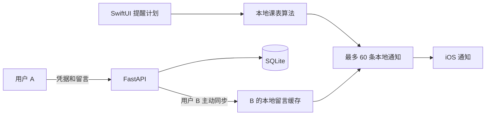

# 架构与后续计划

## iOS 模块

| 模块 | 职责 |
| --- | --- |
| Models | 学期周、单双周、课间、普通规则、去重、候选提醒日期 |
| NotificationScheduler | 权限、通知队列、前台横幅、留言配对 |
| AppStore | 持久化、串行操作、网络同步、消息确认和错误提示 |
| APIClient | HTTP、URL 校验、Keychain |
| PlanView / FriendView / SipTimeApp | 计划编辑、好友交互、首页与补充触发 |

本地计划与留言保存在 Application Support/SipTime/state.json，原子写入，并设置首次解锁后的文件保护。凭据仅保存在 Keychain。无法读取既有数据时停止覆盖，保留排查机会。

AppStore 串行执行操作，避免同时修改通知。重建时先清除自己的待处理队列，再写入新队列；失败时清除本次部分结果并报错。该操作不是系统事务；清空到重建完成之间如果 App 被强制终止，需要重新打开恢复。后续可增加系统队列与本地记录的恢复校验。

## API

除注册和健康检查外，业务接口均需要 `Authorization: Bearer <token>`。凭据仅在注册时返回，服务端仅存 SHA-256 摘要。

| 方法 | 路径 | 用途 |
| --- | --- | --- |
| GET | /health | 进程健康检查 |
| POST | /v1/accounts | 昵称注册，返回凭据 |
| GET | /v1/me | 本人、邀请码与好友昵称 |
| POST | /v1/pair | 邀请码双向绑定 |
| DELETE | /v1/pair | 解绑定并删除双方服务端留言 |
| POST | /v1/notes | 发送，client_id 用于去重 |
| GET | /v1/notes/inbox | 本人待提醒留言 |
| POST | /v1/notes/ack | 收件人确认经过提醒时间的留言 |

注册每连接 IP 每小时最多 10 次，绑定尝试每账号每分钟 10 次，发送每账号每分钟 20 次，待提醒留言最多 20 条。限制器是进程内存实现，重启会重置。当前应使用**单 worker**；公网/多实例部署需共享限流、可信代理和请求大小限制。

SQLite 使用 WAL、外键和 BEGIN IMMEDIATE 事务。排他检查与双向绑定在同一事务内完成。只有绑定双方能发送，只有收件人能读取和确认自己的消息。

已确认消息保留在数据库中用于发送重试去重，没有自动清理期限；解除绑定会删除双方消息。上线前需明确保留期限、账号删除和备份恢复策略。

## 留言生命周期

1. 发送前持久化 client_id，连接失败重试使用相同编号，避免重复。
2. 服务端保存留言，读取 inbox 不会消费它。
3. 接收方同步缓存，留言按顺序与未来提醒一一配对。
4. 未到提醒时间时，改期或暂停会重新配对。
5. 提醒时间经过后，下一次前台处理将留言移入待确认集合。
6. 联网成功后确认；失败保留待确认编号，不重复安排。

确认不是已读，不能证明通知真正展示。解除绑定也无法立即撤回另一台离线设备已经缓存的文字。

## 下一阶段：APNs

要让接收方未打开 App 时也尽量在下次提醒收到新留言，需要：

1. 配置开发者账号、App ID 推送能力、服务端 APNs 密钥。
2. 登记和撤销设备 token，区分开发与生产环境。
3. 同步提醒时间、时区、计划版本与临时暂停状态。
4. 服务端持久任务队列定时组合最新留言并推送。
5. 明确本地/远程通知的主备关系，处理离线、超时、重复送达，避免两条提醒同时出现。

静默推送和后台任务不能保证按时唤醒，不能承诺响起前必定读到最新留言。远程推送也受网络影响。离线提醒与留言新鲜度需要明确取舍。

其他后续项：学校作息导入/导出、课程占用显示、课表 OCR、假期调休、账号恢复。不在第一版引入排行榜和复杂社交。
